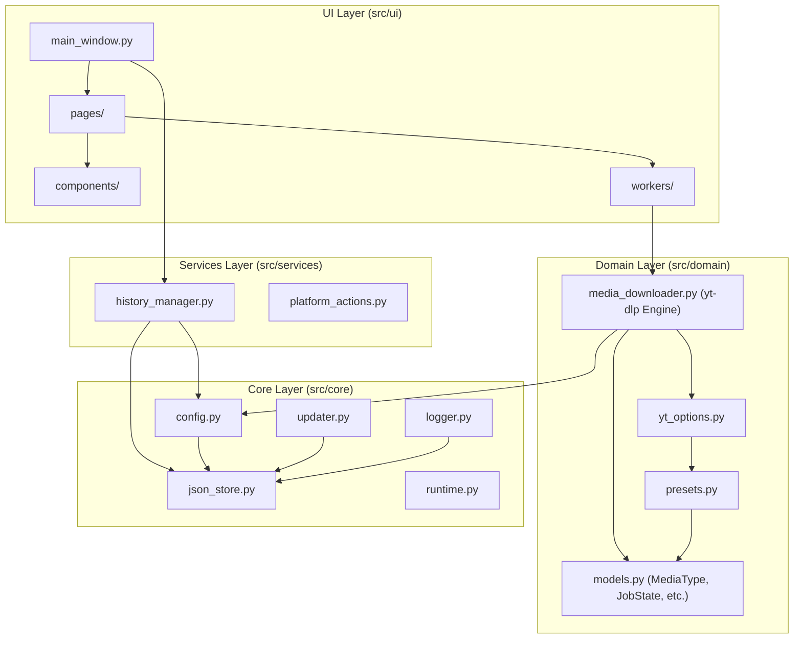

# Media Downloader PRO — Architecture & Layering Diagram

> [!NOTE]
> **Language Policy**: The official documentation, design files, and project rules for Media Downloader PRO are maintained in Thai.

เอกสารนี้ระบุความสัมพันธ์และการจัดแบ่ง Layer ตามสถาปัตยกรรมที่ระบุไว้ใน `PROJECT_RULES.md`

## Architecture Boundaries

สถาปัตยกรรมแบ่งออกเป็น 4 ชั้นหลัก โดยการเรียกใช้งานต้องเป็นทิศทางแบบ **บนลงล่าง (top-down)** เสมอ:
1. **UI Layer** (หน้าตาแอปพลิเคชัน หน้า และ components ต่างๆ)
2. **Services Layer** (จัดการพฤติกรรมของระบบปฏิบัติการและประวัติการทำงาน)
3. **Domain Layer** (โมเดลข้อมูล ตัวแปลงและคำนวณ Preset และ engine ของ yt-dlp)
4. **Core Layer** (การทำงานพื้นฐานของระบบ เช่น การเก็บข้อมูล JSON การตั้งค่า ตัวบันทึก log และกลไก self-updater)

## Boundary Rules

- **UI Isolation**: โค้ดใน UI Layer ห้ามเรียกใช้งานเครือข่าย ห้ามจัดการไฟล์ดาวน์โหลดตรงๆ และห้ามติดต่อกับ yt-dlp โดยไม่ผ่าน Domain/Workers
- **Domain Independence**: โค้ดใน Domain และ Services Layer ห้ามทำการนำเข้า (import) โค้ดใดๆ จาก UI Layer เป็นอันขาด
- **Single Session Isolation**: งานดาวน์โหลดแต่ละงานต้องมี session และ cancellation token แยกเป็นของตนเอง ห้ามแชร์ mutable global state
